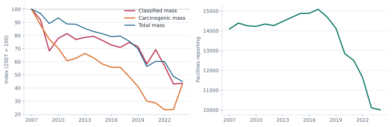
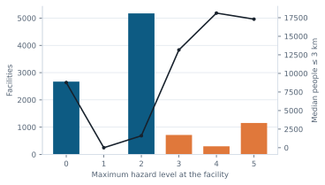
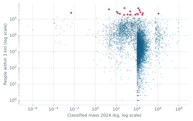
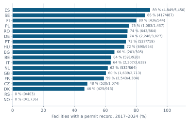

::: {.callout-note}
**Year.** Every figure below uses the latest reporting year, **2024**, unless
it is explicitly a time series. Facilities that did not report in 2024 remain in
the permit and population layers but not in the 2024 mass totals.

**Three mass definitions.** *Total mass* is everything reported (98.2 % of it
is CO₂). *Classified mass* is the mass of substances with a hazard level ≥ 2.
*Carcinogenic mass* is the mass of substances classified IARC 1/2A/2B or CLP
Carc. — the wider IARC flag used in the facility panel also includes group 3
("not classifiable") and is not used here.
:::

## Q1 · Where are Europe's largest releases? {#q1}

Ten thousand facilities reported **1,013 Mt** to air and water in 2024. That
number is dominated by one gas: carbon dioxide accounts for **995 Mt (98.2 %)**.
Any ranking by total mass is therefore a ranking of CO₂ emitters, and the top
of it is the expected list of lignite power stations.

The largest single reporter is the Bełchatów lignite plant in Poland
(27.3 Mt), followed by Boxberg and Jänschwalde in Germany. The table below
shows the largest total masses with their classified share for context.



**Largest total releases, 2024** — click a facility to open it on the map.



## Q2 · Which facilities release the most hazardous mass? {#q2}

Ranking by *classified* mass gives a different map. 7,341 facilities reported
at least one substance with a hazard level ≥ 2, for a combined **1.98 Mt** —
0.2 % of the total mass but the part where the hazard lists have something to
say. Half of it comes from ten facilities (**48.3 %**), and the top of the list
is integrated steel works reporting carbon monoxide, a CLP reproductive
toxicant.

This concentration is real but it is not "the most dangerous facilities":
classified mass still weighs kilograms equally, so a low-potency gas reported
in kilotonnes outranks a potent substance reported in kilograms. Use level and
population alongside it, never instead of it.



*"Largest classified substance" is the heaviest level ≥ 2 substance in the
facility's reported top-three emitters; the full substance list may contain
others.*

## Q3 · Which facilities release the most carcinogenic mass? {#q3}

Carcinogenic mass is **8,244 t** in 2024, reported by 1,764 facilities. Unlike
classified mass it is extremely concentrated: the top ten facilities account
for **68 %**, and a single wastewater treatment plant — EDAR VIC near
Barcelona — reports **3,720 t of DEHP (45.1 %)**, a plasticiser that is an
IARC 2B carcinogen.

This is a reporting story as much as a pollution story. DEHP enters wastewater
from plastics processing; a plant that measures and reports it will dominate a
mass table, while a plant that does not measures nothing. The ranking is a
starting point for questions, not an answer.





::: {.callout-note}
**Why not the dashboard's carcinogen count?** The facility panel shows
`n_carc`, built earlier from "any IARC or CLP entry". That includes IARC group
3 (not classifiable), which is not evidence of carcinogenicity. Adding group 3
would raise the 2024 total from 8.2 kt to 24.0 kt, almost all of it hydrogen
chloride — a useful sensitivity check, not a carcinogen ranking.
:::

## Q4 · How have releases changed since 2007? {#q4}

Between 2007 and 2024, classified mass fell **56 %** (4.54 Mt → 1.98 Mt),
carcinogenic mass fell **57 %** (19.3 kt → 8.2 kt), and total mass fell **55 %**.
The number of reporting facilities fell **29 %** over the same period, so
part of the decline is fewer reporters rather than cleaner processes: the
classified mass per reporting facility still fell **39 %**.

Both series move together, which is reassuring for the direction and
uninformative about the cause. E-PRTR thresholds, annexes, membership and
reporting practice have all changed since 2007; a 2024 facility is not
necessarily the same plant as the 2007 facility at the same site.

{#fig-trend fig-alt="Indexed trend of total, classified and carcinogenic mass 2007-2024, and the number of facilities reporting"}



## Q5 · Which countries carry the most? {#q5}

Germany reports **36.3 %** of all classified mass, more than three times France
(9.8 %) or Poland (9.6 %). That reflects the size of its heavy industry and the
thoroughness of its reporting, not a per-capita comparison: the atlas does not
normalise by population, GDP or industrial output, and it should not be used to
rank countries on "pollution".

The last column is the permit-record coverage for all facilities in that
country (2017–2024), which is discussed in [Q8](#q8).



## Q6 · How many people live near hazardous facilities? {#q6}

The 2021 census grid lets us count residents within 3 km of each facility.
8,994 of the 10,012 facilities that reported in 2024 have a usable estimate
(**89.8 %**); the rest sit outside the grid (UK, Serbia, Iceland, overseas
territories) or in cells the census marks as no-data.

Summing those circles gives **126 million person–facility pairs** within 3 km
of a reporting facility, **48.9 million** of them around facilities with a
hazard level ≥ 3. The word *pairs* matters: a resident living between three
facilities is counted three times. The number is a measure of how much of
Europe's population lives in industrial neighbourhoods, not a count of distinct
people exposed.

The most striking result is that hazard level barely predicts how many people
live nearby. Level 0 facilities — CO₂-only reporters and unclassified plants —
have a higher median (8,773 people within 3 km) than level 2 facilities
(1,608). Large power plants and refineries are often near cities, while many
hazard-listed sites are in industrial zones or rural areas.

{#fig-pop fig-alt="Facilities and median population within 3 km by maximum hazard level"}



*"With population" counts facilities covered by the grid; "People ≤ 3 km (sum)"
adds their 3 km counts and double-counts residents near several facilities.*

## Q7 · Who is most exposed? {#q7}

"Most exposed" here means: lives closest to the most people. Ranking level ≥ 3
facilities by residents within 3 km gives a list of wastewater plants, steel
works and chemical sites inside cities — Ivry-Paris XIII, the Paris sewer
authority, Taranto, Sestao.

The two rankings barely overlap: of the top 20 by classified mass and the top
20 by population, **none** appear in both. Across all 8,994 covered facilities
the rank correlation between classified mass and population is **−0.33** (more
mass goes with fewer neighbours) and between hazard level and population
**0.05** (no relationship). If you want to know who lives next to industrial
hazard, you cannot read it off a mass ranking.



{#fig-exposure fig-alt="Scatter of classified mass against population within 3 km; the twenty most populated sites are highlighted"}

**Top-20 overlap** — cells count facilities present in both rankings:



## Q8 · Are the permits up to date? {#q8}

Only **20,788 of 32,155 facilities (64.6 %)** can be linked to the EEA IED
permit table; among the 10,012 facilities that reported in 2024 the linkage is
**88 %**. The gap has three causes: Norway, Serbia and Switzerland are not in
the table at all, many historical facilities no longer report, and the table
starts in 2017.

Where a record exists, the dates are patchy. **19.2 %** have no valid granting
date (the reporting tool writes 1900-01-01 as a placeholder), and the median
granting date is **14 years before 2024**. More than half of the matched
facilities were granted 11–20 years earlier. The 50 facilities with the largest
classified mass all have a record (98 % with a URL), but only 58 % have a
usable granting date, and their median grant year is **2007**.

This describes the EEA table's completeness, not permit status: a missing date
does not mean an outdated permit, and an old permit does not mean weak
conditions. The IED requires periodic reconsideration; the table records what
countries submitted.



**Coverage by country** (all 32,155 facilities, sorted by coverage):



{#fig-permit fig-alt="Share of facilities with a permit record by country"}

**Level ≥ 3 facilities without a permit record** — absence from this table is
not evidence of operating without a permit:



## What this does not say {#limits}

- **It does not rank facilities by danger.** Hazard levels describe the
  substances, not the exposure, dose or local risk. A level 5 circle in a field
  and a level 2 circle in a city are different problems.
- **It does not compare countries fairly.** Masses are not normalised by
  population, output or industrial structure, and reporting completeness
  varies.
- **It does not prove compliance.** Permit coverage measures whether a row
  exists in a table, not whether a permit is adequate or enforced.
- **It does not count people twice.** It counts person–facility pairs; the
  same resident near several sites appears several times.
- **It does not resolve 2024.** The latest year may still be revised upstream.

Where these limits matter, [Data checks](data-checks.qmd) shows the counts and
[Methodology](methodology.qmd) shows the decisions behind them.
